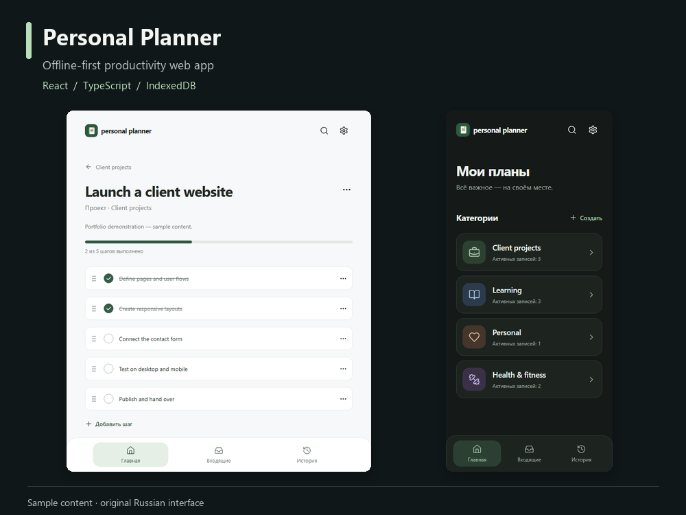

# Personal Planner

An offline-first productivity app for tasks, projects and recurring activities.



**React · TypeScript · Vite · IndexedDB · PWA**

[Watch the 30-second walkthrough](docs/media/demo.mp4) · [Project workflows](docs/media/02-planner-project.png) · [Weekly statistics](docs/media/03-planner-history.png) · [Mobile and dark mode](docs/media/04-mobile-and-dark.png)

## What it does

- Organizes work into categories, a quick-capture inbox and projects with ordered steps.
- Tracks recurring activities, optional session durations and completed work.
- Derives weekly statistics from the underlying records.
- Supports search, light/dark themes and validated JSON backup and restore.
- Keeps working offline after the production app is cached.

The current interface is in Russian. Portfolio media uses fictional sample content.

## Run locally

Use Node.js 22 or newer.

```sh
npm ci
npm run dev
```

Open `http://localhost:5173`.

To try the production build, including the service worker:

```sh
npm run build
npm run preview
```

Open `http://localhost:4173`. After the first successful online load, disconnect the network and reload to try offline use. The empty start screen includes an optional sample-data button.

## Checks

```sh
npm run typecheck
npm test
npm run build
npx playwright install chromium webkit
npm run test:e2e
```

The business-logic tests cover history consistency, weekly statistics, project ordering, transactional changes and backup validation. Browser scenarios exercise actual app flows and offline use.

## Project map

| Path | Purpose |
| --- | --- |
| `src/data` | Models, IndexedDB persistence, transactions and backup validation |
| `src/domain` | Activity history, project progress and weekly statistics |
| `src/pages` | Home, inbox, project, history, search and settings screens |
| `src/ui` | Shared forms, controls and interaction components |
| `e2e` | Browser workflow and offline scenarios |

## Data model and boundaries

Data is stored locally in the browser. There are no accounts or automatic cross-device synchronization. Export/import is the supported transfer method. Clearing browser storage can remove records, so keep backups. Safari and an installed iPhone PWA may have separate storage.

The walkthrough demonstrates offline reload and task creation. It does not claim physical iPhone validation.
